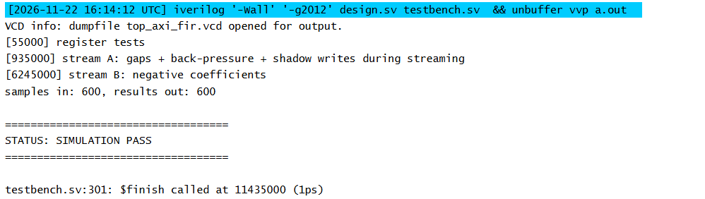
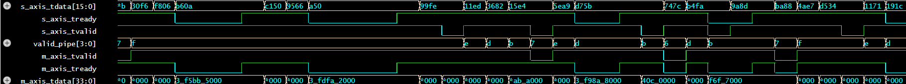

# AXI FIR Filter IP

A 4-tap FIR filter with an AXI4-Stream data path and an AXI4-Lite register interface for the coefficients, written in Verilog and verified with a self-checking testbench.

## Features

- AXI4-Stream input (16-bit signed samples) and output (34-bit signed results)
- 4-stage pipeline with full back-pressure support: when `m_axis_tready` is low, the output holds and `s_axis_tready` goes low
- AXI4-Lite slave for the four 16-bit coefficients
- Shadow registers: new coefficients are written to shadow registers and applied together with a single commit write, so the filter never runs with a mix of old and new coefficients
- Byte-lane writes using WSTRB
- SLVERR response for unmapped or misaligned addresses

## Register map

| Offset | Name | Access | Description |
|--------|------|--------|-------------|
| `0x00` | C0 | R/W | Shadow coefficient 0 |
| `0x04` | C1 | R/W | Shadow coefficient 1 |
| `0x08` | C2 | R/W | Shadow coefficient 2 |
| `0x0C` | C3 | R/W | Shadow coefficient 3 |
| `0x10` | COMMIT | W | Write 1 to copy all shadow coefficients to the active coefficients |

## Files

| File | Description |
|------|-------------|
| `design.sv` | AXI4-Lite slave, AXI4-Stream FIR and top level |
| `testbench.sv` | Self-checking testbench |

## Verification

Every output sample is compared against a reference model inside the testbench.

1. Register tests: write and read-back, byte strobes, SLVERR for unmapped (`0x14`) and misaligned (`0x02`) addresses
2. Stream A: 300 samples with coefficients `1000, 2000, 2000, 1000`, random input gaps and random back-pressure. New coefficients are written to the shadow registers during streaming and must not change the output
3. Commit of the new coefficient set (`F800, 4000, 7FFF, 8000`)
4. Stream B: 300 samples with negative coefficients

600 samples in, 600 results out, all matching the model.

Simulated with Icarus Verilog on EDA Playground.

## Results

### Simulation result

### Coefficient commit

A write of `1` to address `0x10`. All four active coefficients `c0`–`c3` change on the same clock edge to the shadow values.

### Stream back-pressure

While `m_axis_tready` is low, `m_axis_tdata` and `m_axis_tvalid` hold their values and `s_axis_tready` goes low, so no data is lost.

